# Credits & Attribution

## STAGELIGHT

**Created by DeJuan McCoy.**

STAGELIGHT is a VFX-style relighting tool for AI-generated images, built as a
ComfyUI plugin. It is free and open-source.

 

---

STAGELIGHT is built on excellent open-source work by others. Please respect
these licenses, especially for commercial use.

## Core relighting concept

- **IC-Light** — Lvmin Zhang (lllyasviel), Anyi Rao, Maneesh Agrawala
  https://github.com/lllyasviel/IC-Light
  IC-Light v1 models: Apache 2.0. IC-Light v2: non-commercial.

- **ComfyUI-IC-Light** — kijai
  https://github.com/kijai/ComfyUI-IC-Light

## Models STAGELIGHT uses

- **MiDaS / DPT (dpt-hybrid-midas)** — Intel ISL — MIT License
- **rembg** — Daniel Gatis — MIT License
- **Z Image Turbo** — verify its license page
- **SD 1.5 checkpoints** — each independently licensed (usually CreativeML OpenRAIL-M)
- **BRIA RMBG 1.4** — if used by IC-Light: non-commercial

## Libraries & frameworks

- **ComfyUI** — comfyanonymous & contributors — GPL-3.0
- **Three.js** — MIT
- **PySide6 / Qt for Python** — LGPL-3.0
- **PyTorch** — BSD-style
- **Hugging Face transformers** — Apache 2.0
- **NumPy, Pillow, SciPy, timm, onnxruntime, controlnet-aux** — permissive (BSD/MIT/Apache)

## Design influences

- The Foundry's **Nuke** — grade-chain and relight UX inspiration
- **Maya** — viewport camera orbit and gizmo interaction model

## Commercial use

STAGELIGHT's code is MIT (free). Output depends on which models you run:

- IC-Light **v1** + commercial SD 1.5 + commercial BG remover → commercial OK
- IC-Light **v2**, BRIA RMBG 1.4, or non-commercial checkpoint → non-commercial only

Check each model's license page. This is a pointer, not legal advice.
