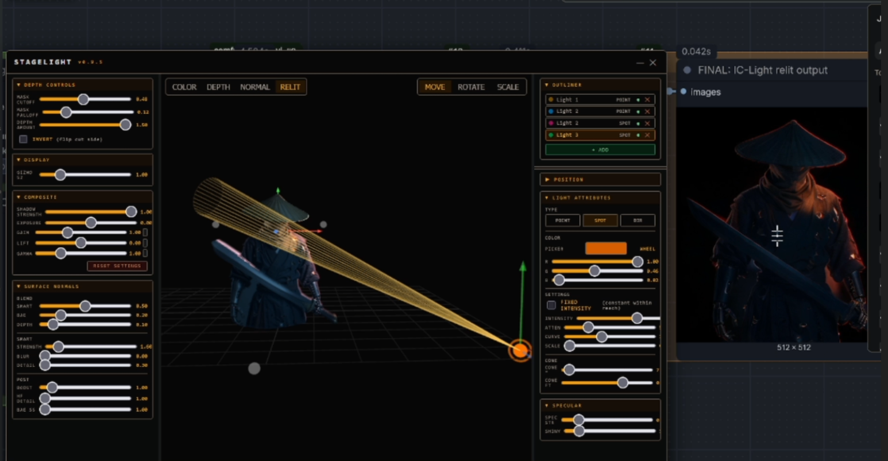
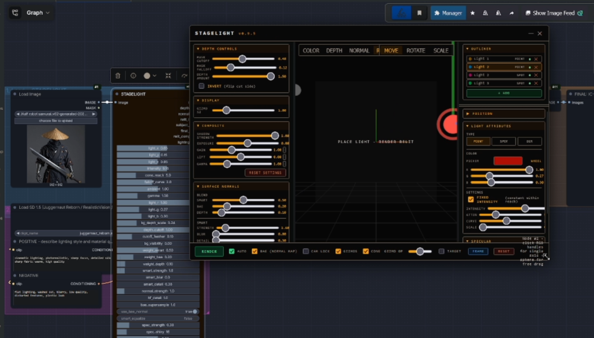

# STAGELIGHT

**VFX-style relighting for AI-generated images, inside ComfyUI.**

Created by **DeJuan McCoy**.

Instead of fighting with prompts to describe lighting, you place actual lights
in a 3D viewport — point, spot, and directional lights with color, falloff,
and specular control — then let an AI cleanup pass turn your lit composite into
a photorealistic image. Think Nuke's relight node meets Maya's viewport,
feeding a diffusion model.

---

## What it does

1. **Depth + normal estimation** from any image (MiDaS + blended normal map)
2. **3D viewport relighting** — image becomes a depth-displaced mesh; place
   multiple colored lights with a Maya-style orbit camera
3. **Deterministic GPU Phong lighting** — what you see is what renders
4. **AI cleanup** via Z Image Turbo (fast) or IC-Light (photoreal material
   response, real rim lighting)

---

## Requirements

- ComfyUI (recent), Python 3.10+, a CUDA GPU (8GB VRAM works)
- For the IC-Light workflow: an SD 1.5 checkpoint + IC-Light fc model +
  kijai's ComfyUI-IC-Light extension

## Required model downloads (IC-Light path)

1. **SD 1.5 photoreal checkpoint** (~2GB) → `ComfyUI/models/checkpoints/`
   - Juggernaut Reborn: https://huggingface.co/HyperX-Sentience/Juggernaut-Reborn/resolve/main/juggernaut_reborn.safetensors

2. **IC-Light fc model** (~1.7GB) → `ComfyUI/models/unet/`
   - https://huggingface.co/lllyasviel/ic-light/resolve/main/iclight_sd15_fc.safetensors

3. **kijai's ComfyUI-IC-Light extension** — install via ComfyUI Manager → Custom Nodes Manager → search "IC-Light".

---

## Install

1. (Optional, Windows) Double-click `install_dependencies.bat` to pip-install
   the Python packages STAGELIGHT needs
2. Run the installer — Windows: double-click `bootstrap.bat`; otherwise
   `python installer.py`
3. **BROWSE** to your ComfyUI folder
4. **KILL COMFYUI** if it's running (prevents file locks)
5. **INSTALL**
6. **OPEN COMFYUI**
7. **Hard-refresh the browser (Ctrl+Shift+R)** — this matters. After any
   re-install, ComfyUI's browser cache will often serve a stale copy of the
   STAGELIGHT panel. If the panel looks broken or images won't load, the fix
   is almost always a hard-refresh.
8. Add the **STAGELIGHT** node or load a workflow from `workflows/`

---

## Workflows

- `workflows/stagelight_zimage_cleanup.json` — fast cleanup
- `workflows/stagelight_iclight_relight.json` — photoreal relighting

For best color preservation with IC-Light, **set the KSampler `denoise` to
`0.5`** (it ships at 1.0 — change it to 0.5 once after opening the workflow).
This is the setting that captures STAGELIGHT's lighting colors well.

See `workflows/README.md` for the full guide.

---

## Credits

STAGELIGHT is built on a lot of open-source work — IC-Light (lllyasviel),
kijai's ComfyUI extension, MiDaS, rembg, Three.js, ComfyUI, and more. Full
attribution and licenses in `CREDITS.md`. Please respect those licenses for
commercial use.

---

## License

MIT (see `LICENSE`) for STAGELIGHT's own code. Bundled AI models have their
own licenses — check `CREDITS.md` before using output commercially.

---

## Support

STAGELIGHT is free. If it's useful and you want to support development, see
the funding link in the repo. No pressure — free either way.
